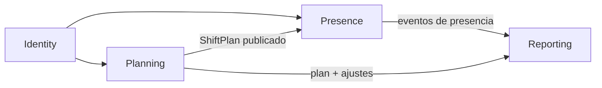
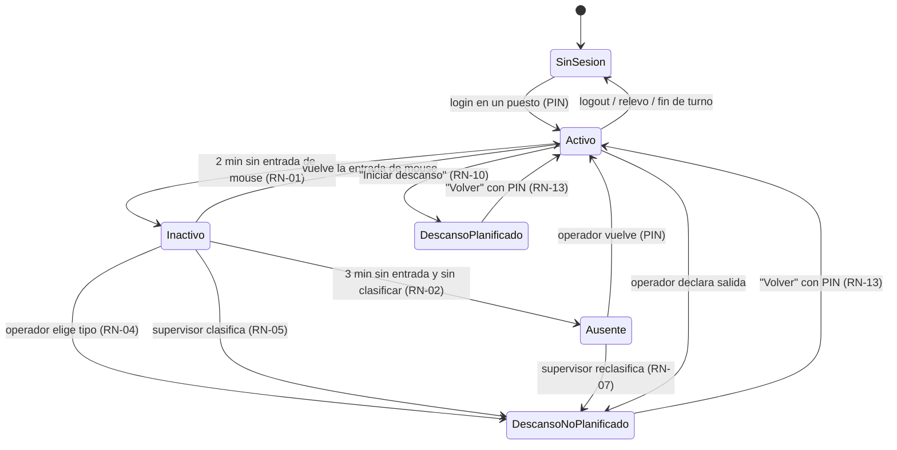

# 02 — Modelo de dominio

> Fuentes: entrevistas con el supervisor, cronograma de guardias de noviembre 2026 (grupos A–D) y esquema de descansos del grupo C.
> Las afirmaciones marcadas **[Supuesto]** deben confirmarse (ver `05-preguntas-abiertas.md`).

## 0. Alcance del dominio

- Solo **operadores de monitoreo** (sección **AO** del cronograma).
- Los operadores de **911 (AT)** quedan **fuera**: atienden teléfonos, tienen sus propios descansos y su propio supervisor.
- La hoja de **Analítica** queda fuera: no tiene gestión de descansos.

## 1. Lenguaje ubicuo (glosario)

| Término (negocio) | Identificador (código) | Definición |
|---|---|---|
| Grupo | `Group` | Conjunto fijo de operadores asignado a un turno: A (00–06), B (06–12), C (12–18), D (18–00). Cada grupo tiene su supervisor. |
| Turno | `Shift` | Ventana de 6 h de un grupo. Ocurre en una **fecha operativa**. |
| Fecha operativa | `OperationalDate` | Fecha del **inicio** del turno. El turno 18–00 del 17/11 pertenece al 17/11. |
| Operador | `Operator` | Operador de monitoreo, identificado por legajo. |
| Puesto | `Workstation` | Posición física de monitoreo (una PC), numerada del 1 al 20, con su ubicación (fila y columna) en la sala. |
| Puesto fuera de servicio | `OutOfService` | Puesto roto o no disponible. No se habilita ni se le asignan operadores hasta que vuelve a servicio. |
| Puesto habilitado | `EnabledWorkstation` | Puesto en servicio que se ocupa en un turno concreto. Un puesto en servicio sin operador queda **vacante** y no cuenta para la cobertura. |
| Cronograma de guardias | `DutyRoster` | Planificación mensual: código por operador y día (G, F, LIC…). |
| Esquema de descansos | `BreakScheme` | Define **cuándo** sale cada ola: olas, franjas (horario relativo + duración) y la **distribución** de puestos en olas. |
| Esquema base | `BaseScheme` (`Scope = Base`) | Esquema de referencia que mantiene Coordinación. Hoy es **uno solo para los 4 grupos**. |
| Esquema del grupo | `GroupScheme` (`Scope = Group`) | Copia del esquema base que el supervisor de un grupo **ajusta por razones operativas**. |
| Posición | `Position` | Lugar numerado del esquema. **1–20 son puestos físicos** y **21–25 son posiciones de relevo**. Cada posición pertenece a una ola. |
| Posición de relevo | `ReliefPosition` | Posición del esquema (21–25) que ocupa un relevista. Define en qué ola descansa. |
| Ola | `Wave` | Conjunto de posiciones (puestos y relevos) que salen a descanso juntas y comparten horarios. |
| Franja | `BreakSlot` | Descanso de una ola: desplazamiento desde el inicio del turno + duración. |
| Distribución | `WaveLayout` | Regla que asigna cada posición a una ola: **por columna**, **por fila** o **personalizada** (posición por posición). |
| Plan del turno | `ShiftPlan` | Plan concreto de una fecha y un grupo: puestos habilitados, quién ocupa cada uno, relevistas y descansos. Admite ajustes solo para ese día. |
| Asignación de puesto | `WorkstationAssignment` | Operador → puesto para un turno. |
| Relevista | `Reliever` | Operador de guardia que excede la cantidad de puestos habilitados (p. ej. 17 personas y 15 puestos → 2 relevistas). Ocupa una posición de relevo, descansa con la ola de esa posición y, mientras tanto, cubre los puestos de las otras olas. |
| Cobertura de relevo | `ReliefCoverage` | Qué relevista cubre qué puesto en cada franja. El sistema la sugiere y el supervisor la puede cambiar. |
| Descanso planificado | `PlannedBreak` | Descanso concreto de un operador, derivado del plan del turno. |
| Reprogramación | `BreakReschedule` | Cambio en vivo de un descanso del día (adelantar, posponer, cancelar). |
| Descanso no planificado | `UnplannedBreak` | Salida no prevista, clasificada por tipo. |
| Sesión de puesto | `WorkstationSession` | Período en que un operador está logueado en un puesto. |
| Estado de presencia | `PresenceStatus` | Estado del operador (ver §5). |
| Inactividad | `Idle` | Período sin entrada de mouse mayor al umbral. |
| Ausencia | `Absence` | Inactividad no clasificada que supera el umbral de ausencia. |
| Reclasificación | `Reclassification` | Cambio posterior de la clasificación de un período. Siempre auditado. |
| Adherencia | `Adherence` | Comparación entre lo planificado y lo real. |
| Cobertura mínima | `MinimumCoverage` | Mínimo de puestos habilitados que deben estar cubiertos en todo momento (por grupo). |
| Aviso de privacidad | `PrivacyNotice` | Texto versionado que informa la existencia del control de actividad. |

## 2. Módulos (bounded contexts dentro del monolito)

| Módulo | Responsabilidad | Agregados principales |
|---|---|---|
| **Identity** | Usuarios y roles, operadores, puestos (PCs enroladas), aceptación de avisos | `UserAccount`, `Operator`, `Workstation`, `PrivacyNotice` |
| **Planning** | Cronograma de guardias, esquemas de descanso (base y del grupo), plan del turno, relevos | `DutyRoster`, `BreakScheme`, `ShiftPlan` |
| **Presence** | Sesiones, eventos de presencia, estado actual, descansos reales, reclasificaciones | `WorkstationSession`, `OperatorPresence` (+ `PresenceEvent` append-only) |
| **Reporting** | Proyecciones e informes (adherencia, ausencias, inactividad, cobertura) | Proyecciones de lectura |

## 3. Agregados y entidades

### Planning

- **DutyRoster** (raíz) — `Month`, `Group`, `Entries[]`
  - `RosterEntry` — `OperatorId`, `Date`, `RosterCode`
  - Invariante: un código por operador y por día.
- **BreakScheme** (raíz) — `Scope` (Base | Group), `Group?`, `DerivedFromSchemeId?`, `Version`, `ValidFrom`, `WorkstationPositions` (1–20), `ReliefPositions` (21–25), `Waves[]`, `Layout`, `ChangeReason`
  - `Wave` — `Number`, `Slots[]`
  - `BreakSlot` — `Order`, `Offset` (desde el inicio del turno), `Duration`
  - `WaveLayout` — `Mode` (ByColumn | ByRow | Custom), `Assignments` (posición → ola; calculadas en ByColumn y ByRow, explícitas en Custom)
  - Las versiones son **inmutables**: modificar crea una versión nueva con vigencia y motivo.
- **ShiftPlan** (raíz) — `OperationalDate`, `Group`, `SchemeVersionId`, `EnabledWorkstations[]`, `Assignments[]` (operador → posición, sea puesto o relevo), `DayOverrides[]`, `PlannedBreaks[]`, `ReliefCoverage[]`, `Status` (Borrador/Publicado)
  - `DayOverride` — ajuste solo para ese día (mover una posición de ola, cambiar una franja, cambiar la distribución), con motivo y autor.
  - `ReliefCoverage` — `SlotStart`, `RelieverId`, `WorkstationNumber`, `Origin` (Sugerida | Supervisor)
  - `PlannedBreak` — `OperatorId`, `StartsAt`, `EndsAt`, `Origin` (Esquema | AjusteDelDía | Reprogramación), `Status` (Pendiente/EnCurso/Cumplido/Demorado/NoTomado/Reprogramado/Cancelado)

### Presence

- **WorkstationSession** (raíz) — `WorkstationId`, `OperatorId`, `StartedAt`, `EndedAt?`, `EndReason` (Logout/Relevo/Desconexión/FinDeTurno)
- **OperatorPresence** (raíz, una por operador y turno) — `OperatorId`, `OperationalDate`, `CurrentStatus`, `CurrentPeriod`
  - Produce **PresenceEvent** (append-only): `Id` (UUID v7), `Type`, `OperatorId`, `WorkstationId?`, `OccurredAt`, `ReceivedAt`, `Source` (Agent/Supervisor/System), `Flags` (Deferred, ClockSuspect), `Data`
  - `ActualBreak` — `Kind` (Planificado/NoPlanificado/Ausencia), `Type?`, `StartedAt`, `EndedAt?`, `PlannedBreakId?`
  - `Reclassification` — `PeriodId`, `From`, `To`, `ByUserId`, `At`, `Reason`

### Identity

- **Operator** — `EmployeeNumber`, `FullName`, `Group`, `HomeWorkstation?`, `Active`, PIN (hash)
- **Workstation** — `Number`, `Row`, `Column` (ubicación física en la sala), `Hostname`, `DeviceTokenHash`, `ServiceStatus` (EnServicio | FueraDeServicio, con motivo, desde y autor), `Active`
- **UserAccount** — usuario web con rol (Supervisor con su grupo, Coordinador, Calidad, Administrador)
- **PrivacyNotice** / `NoticeAcceptance` — `OperatorId`, `Version`, `AcceptedAt`, `WorkstationId`

## 4. Códigos del cronograma de guardias

| Código | Significado | ¿Trabaja? | ¿Se planifican descansos? |
|---|---|---|---|
| G | De guardia (planificado) | Sí | Sí |
| C/G | Cambio de guardia | Sí | Sí |
| P | Presente (histórico) | Sí | — |
| P/T | Presente con tardanza (histórico) | Sí | — |
| F | Franco | No | No |
| FC | Franco compensatorio | No | No |
| LIC | Licencia | No | No |
| AJ | Ausencia justificada | No | No |
| A | Ausente | No | No |
| E | Enfermedad | No | No |

- El sistema **planifica** con G y C/G. La asistencia real la **produce** el sistema a partir de las sesiones.
- El importador lee **solo la sección AO** de cada hoja de grupo, normaliza el formato ("p" → "P") y rechaza con un reporte los códigos desconocidos.
- Las filas de totales no se importan: se recalculan.

## 5. Estados de presencia

**Desconectado** es una condición superpuesta: sin heartbeats durante `HeartbeatTimeout`, el operador y el puesto se marcan *Desconectado* hasta que el agente reconecta (RN-15).

## 6. Catálogo de descansos no planificados (inicial, configurable)

| Código | Nombre |
|---|---|
| `BATHROOM` | Baño |
| `MEDICAL` | Médico / malestar |
| `PHONE_CALL` | Llamada |
| `TECH_FAILURE` | Falla técnica |
| `SUPERVISOR_CALL` | Convocado por el supervisor |

## 7. Reglas de negocio

### Presencia e inactividad

- **RN-01 — Inactividad:** si pasan `IdleThreshold` (2 min) sin entrada de **mouse** (movimiento, clic o rueda), se registra `IdleStarted` y el operador pasa a *Inactivo*. **Se registra siempre**, aunque luego vuelva la actividad. El teclado no cuenta.
- **RN-02 — Ausencia automática:** si se alcanzan `AbsenceThreshold` (3 min desde la última entrada) sin clasificación, pasa a *Ausente* (`Source = System`).
- **RN-03 — Retrofechado:** inactividades, ausencias y descansos no planificados que se clasifican desde *Inactivo* comienzan en el **instante de la última entrada de mouse**.
- **RN-04 — Clasificación por el operador:** el operador elige un tipo del catálogo desde *Inactivo*, o declara una salida desde *Activo*.
- **RN-05 — Clasificación por el supervisor:** el supervisor clasifica desde la web la inactividad de un operador de su grupo.
- **RN-06 — Sin inactividad en descanso:** en *DescansoPlanificado* o *DescansoNoPlanificado* no se evalúa la inactividad.
- **RN-07 — Reclasificación auditada:** se conserva el valor original. Se registran autor, fecha y hora, y motivo (obligatorio). Nunca se modifica el evento original.
- **RN-08 — Hora del servidor:** el instante oficial lo determina el servidor (ADR-0004).

### Descansos planificados

- **RN-10 — Inicio:** el agente avisa `PreNotice` (1 min) antes y en el horario. El operador pulsa "Iniciar descanso".
- **RN-11 — Demora:** si el descanso no se inició pasados `LateStartTolerance` (5 min), se registra `PlannedBreakDelayed`. Se puede iniciar igual. Si termina el turno sin iniciarlo, queda *NoTomado*.
- **RN-12 — Exceso:** si dura más que lo previsto + `OverrunTolerance` (1 min), se registra `BreakOverrun`.
- **RN-13 — Regreso con PIN:** volver de cualquier descanso exige el PIN del operador.
- **RN-14 — Reprogramación en vivo:** el supervisor adelanta, pospone o cancela un descanso del día con motivo, y queda auditado. El agente vuelve a avisar en el nuevo horario.

### Puestos, sesiones y relevos

- **RN-15 — Desconexión:** sin heartbeat durante `HeartbeatTimeout` (30 s) → *Desconectado*. No es lo mismo que *Ausente*.
- **RN-16 — Atribución por sesión:** la actividad de un puesto se atribuye al operador con sesión abierta. Máximo una sesión abierta por puesto y una por operador.
- **RN-17 — Relevo:** cuando el titular está en descanso, un relevista abre sesión en ese puesto. La sesión del titular se cierra con `EndReason = Relevo`, pero su estado sigue siendo *DescansoPlanificado*. Al volver, el titular abre sesión con PIN y la sesión del relevista se cierra.
- **RN-18 — Puesto cubierto:** un puesto habilitado está cubierto si tiene sesión abierta con un operador *Activo* o *Inactivo*.
- **RN-19 — Cobertura mínima:** si los puestos cubiertos caen por debajo de `MinimumCoverage` del grupo, el tablero muestra una alerta.

### Esquemas de descanso y planificación

- **RN-20 — Horarios relativos:** las franjas se expresan como desplazamiento desde el inicio del turno. El mismo esquema sirve para los 4 grupos (hoy usan todos el mismo).
- **RN-21 — Dentro del turno:** toda franja empieza y termina dentro de las 6 h. *(Bloqueante)*
- **RN-22 — Sin solapes en una ola:** las franjas de una ola no se superponen. *(Bloqueante)*
- **RN-23 — Simultaneidad máxima:** en ningún minuto puede haber más de `MaxConcurrentWaves` olas en descanso. *(Advertencia, con los minutos en conflicto)*
- **RN-24 — Cobertura planificada:** al generar o ajustar un plan se calcula minuto a minuto: cubiertos = puestos habilitados con operador − puestos en descanso + mín(puestos en descanso, relevistas cuya ola no está en descanso). Si queda por debajo de `MinimumCoverage`, se advierte.
- **RN-25 — Relevistas:**
  - Por defecto se habilitan todos los puestos **en servicio** (RN-34).
  - Si hay más operadores presentes que puestos habilitados, cada puesto queda con un titular y **el excedente son relevistas**. Ejemplo: 17 personas y 15 puestos habilitados → 15 titulares y 2 relevistas.
  - Los relevistas ocupan las posiciones de relevo en orden (21, 22, …). El supervisor puede elegir otra posición, y con eso cambia la ola en la que descansa cada uno.
  - Si hay más relevistas que posiciones de relevo (más de 5), el excedente se marca para que el supervisor lo resuelva (advertencia).
  - Si hay menos operadores que puestos, los puestos sin titular quedan **vacantes** y no hay relevistas (es el caso más común).
  - El supervisor decide **quién** es relevista y puede cambiarlo durante el turno.
- **RN-26 — Publicación:** el plan se edita en *Borrador* y se **publica** para que lo reciban los agentes. Los cambios posteriores son reprogramaciones (RN-14).
- **RN-27 — Distribución:** toda posición (puestos 1–20 y relevos 21–25) pertenece a **exactamente una** ola. *(Bloqueante)* Modos:
  - **Por columna** (por defecto, el esquema actual): posición *n* → ola `((n − 1) mod 5) + 1`. La ola 1 = 1-6-11-16 + relevo 21. Cada ola tiene 4 puestos y 1 relevista.
  - **Por fila:** posición *n* → ola `((n − 1) div 5) + 1`. Las olas 1–4 son filas de 5 puestos y la ola 5 son los 5 relevistas: **los relevistas salen en el último descanso de cada ronda**.
  - **Personalizada:** el supervisor asigna posición por posición.
  - Los puestos fuera de servicio o vacantes y las posiciones de relevo sin relevista no generan descansos.
- **RN-28 — Niveles de ajuste y precedencia:** reprogramación en vivo > ajuste del día (plan del turno) > esquema del grupo > esquema base. Ajustar un nivel **nunca** modifica los niveles superiores.
- **RN-29 — Motivo obligatorio:** todo ajuste de esquema del grupo, del plan del día o de una reprogramación exige un **motivo operativo** y queda auditado (autor, fecha y hora, antes y después).
- **RN-30 — Copia al personalizar:**
  - Cuando un supervisor personaliza, el esquema del grupo nace como **copia** de la versión vigente del esquema base.
  - Los cambios posteriores del base **no se propagan** solos: se avisa al supervisor y él decide si los incorpora.
  - Siempre puede **restablecer** el esquema del grupo al base.
- **RN-31 — Vigencia:** cada versión de esquema rige desde una fecha (`ValidFrom`). Los planes ya publicados conservan la versión con la que se generaron.
- **RN-32 — Descansos de relevistas:** cada relevista descansa con la ola de su posición de relevo, igual que un titular. No hay una regla aparte: la distribución lo resuelve.
- **RN-33 — Alcance por rol:** el supervisor ajusta el esquema y los planes **de su grupo**. Coordinación ajusta el esquema base y puede intervenir en cualquier grupo.
- **RN-34 — Puesto fuera de servicio:**
  - El supervisor o el Admin marcan un puesto como fuera de servicio, con motivo (p. ej. "PC rota"), y lo vuelven a poner en servicio. Queda auditado.
  - Un puesto fuera de servicio no se habilita en los planes nuevos.
  - Si ocurre durante un turno publicado, su titular pasa a otro puesto vacante (si hay) o queda como relevista, a criterio del supervisor. El tablero lo muestra.
- **RN-35 — Cobertura de relevo sugerida:**
  - Para cada franja, el sistema propone qué relevista libre (cuya ola no está en descanso) cubre cada puesto de la ola que sale, en orden de número de puesto.
  - El supervisor puede cambiar la propuesta en el plan o en vivo (HU-33). Si faltan relevistas, los puestos sin cubrir se marcan en la línea de tiempo.

## 8. Esquema base vigente (el del grupo C, confirmado)

5 olas, 6 descansos por ola: 10 + 20 + 10 + 10 + 10 + 10 = **70 min**.
El esquema tiene **25 posiciones**: los **puestos 1–20** (la sala) y las **posiciones de relevo 21–25**. Así el relevo ya está incorporado en el esquema: cada relevista descansa con la ola de su posición.

| Ola (por columna) | Posiciones | D1 (10′) | D2 (20′) | D3 (10′) | D4 (10′) | D5 (10′) | D6 (10′) |
|---|---|---|---|---|---|---|---|
| 1 | 1-6-11-16 + relevo 21 | +0:10 | +1:00 | +2:40 | +3:30 | +4:20 | +5:10 |
| 2 | 2-7-12-17 + relevo 22 | +0:20 | +1:20 | +2:50 | +3:40 | +4:30 | +5:20 |
| 3 | 3-8-13-18 + relevo 23 | +0:30 | +1:40 | +3:00 | +3:50 | +4:40 | +5:30 |
| 4 | 4-9-14-19 + relevo 24 | +0:40 | +2:00 | +3:10 | +4:00 | +4:50 | +5:40 |
| 5 | 5-10-15-20 + relevo 25 | +0:50 | +2:20 | +3:20 | +4:10 | +5:00 | +5:50 |

En el grupo C (inicio a las 12:00), +0:10 = 12:10 … +5:50 = 17:50.
La ola 4 empieza a las 12:40: corrige el 12:30 que figuraba en la planilla. Con esa corrección, en ningún minuto hay más de una ola en descanso (verificado minuto a minuto).

**Cómo funciona el relevo por columna:** cuando sale la ola 1 (puestos 1, 6, 11 y 16 y el relevista 21), los relevistas 22–25, que no están en descanso, cubren esos 4 puestos. Con 5 relevistas, cada ola deja 4 puestos y quedan 4 relevistas libres: la cobertura es completa.

**Distribución por fila**, para comparar:

| Ola | Por columna (por defecto) | Por fila |
|---|---|---|
| 1 | 1-6-11-16 + relevo 21 | 1-2-3-4-5 |
| 2 | 2-7-12-17 + relevo 22 | 6-7-8-9-10 |
| 3 | 3-8-13-18 + relevo 23 | 11-12-13-14-15 |
| 4 | 4-9-14-19 + relevo 24 | 16-17-18-19-20 |
| 5 | 5-10-15-20 + relevo 25 | relevos 21-22-23-24-25 |

Por fila, los relevistas salen todos en **el último descanso de cada ronda**. En las olas 1–4 salen 5 puestos y los cubren los 5 relevistas.

**Cobertura simulada minuto a minuto (20 puestos habilitados):**

| Relevistas | Por columna (mínimo cubierto) | Por fila (mínimo cubierto) |
|---|---|---|
| 5 | 20 / 20 | 20 / 20 |
| 2 | 17 / 20 | 17 / 20 |
| 0 | 16 / 20 | 15 / 20 |

Con 15 puestos habilitados (5 fuera de servicio) y 2 relevistas, por columna: 13 / 15.

**Trade-off:**
- *Por columna* reparte los huecos en toda la sala, y si faltan relevistas descubre menos puestos a la vez.
- *Por fila* concentra la salida en una zona y deja el descanso de los relevistas para el final de cada ronda.

El sistema muestra esta simulación para cada opción, así el supervisor decide.

## 9. Dotación observada (cronograma de noviembre)

Operadores de monitoreo (AO) de guardia por día, en los días con planificación G:

| Grupo | Mínimo | Máximo |
|---|---|---|
| A | 14 | 18 |
| B | 16 | 21 |
| C | 16 | 22 |
| D | 15 | 21 |

(Se excluye un día del grupo A con 1 solo operador cargado, probablemente incompleto.)

**Implicancia (confirmada con el supervisor):** con 20 puestos, lo normal es que haya **menos o casi la misma gente que puestos**, sin relevistas. Puede haber relevistas en dos casos:
- Días con 21 o 22 operadores.
- Puestos fuera de servicio (p. ej. 17 personas y 15 puestos habilitados → 2 relevistas).

Por eso el modelo calcula los relevistas a partir de los **puestos en servicio** y no de un número fijo de puestos.

## 10. Parámetros configurables (valores iniciales)

| Parámetro | Valor | Alcance |
|---|---|---|
| `IdleThreshold` | 2 min | Global |
| `AbsenceThreshold` | 3 min desde la última entrada | Global |
| `PreNotice` | 1 min | Global |
| `LateStartTolerance` | 5 min | Global |
| `OverrunTolerance` | 1 min | Global |
| `HeartbeatInterval` / `HeartbeatTimeout` | 10 s / 30 s | Global |
| `MaxConcurrentWaves` | 1 | Por esquema |
| `MinimumCoverage` | A definir | Por grupo |
| `ActivityPolicy` | `MouseOnly` | Global |
| `DataRetention` | A definir | Global |
