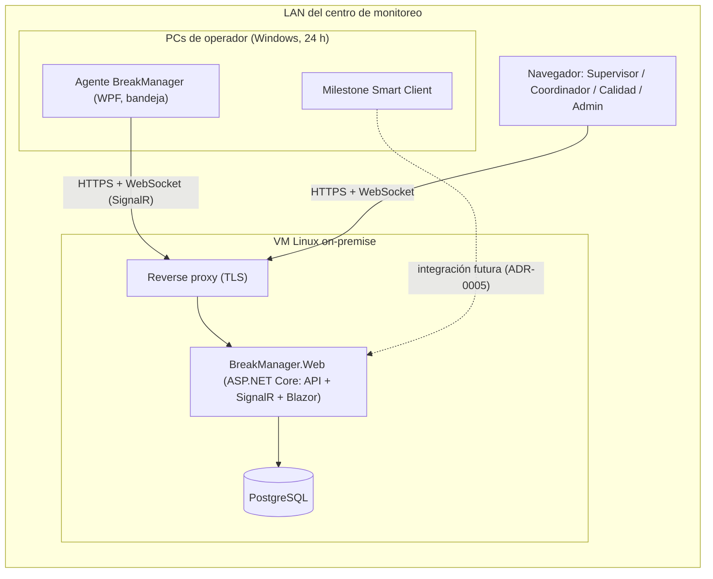

# 03 — Arquitectura

## 1. Contexto



## 2. Contenedores y responsabilidades

| Pieza | Tecnología | Responsabilidad |
|---|---|---|
| **Agente** | .NET 10, WPF, `net10.0-windows`, SQLite (outbox) | Login del operador, avisos, descansos, detección de inactividad (Raw Input), heartbeat, cola offline |
| **Servidor** | ASP.NET Core 10 (un solo host) | API REST para comandos, hub SignalR para agentes y tablero, web Blazor (Interactive Server) para los roles web, jobs en segundo plano (umbrales, timeouts, publicación) |
| **Base de datos** | PostgreSQL (versión mayor fijada en compose) | Persistencia transaccional y vistas o proyecciones para informes |
| **Reverse proxy** | Caddy o Nginx | Terminación TLS con certificado de una CA interna |

Un solo proceso servidor y un solo contenedor de aplicación: es lo más simple de operar en una VM (ADR-0001).

## 3. Capas (Clean Architecture)

```
             ┌─────────────────────────────┐
             │   Web (host)   Agent.Windows│   ← adaptadores de entrada / composition roots
             ├─────────────────────────────┤
             │       Infrastructure        │   ← EF Core, PostgreSQL, ClosedXML, SignalR notifier, Identity
             ├─────────────────────────────┤
             │         Application         │   ← casos de uso (comandos/consultas), puertos, validación
             ├─────────────────────────────┤
             │           Domain            │   ← entidades, value objects, reglas, eventos de dominio
             └─────────────────────────────┘
    Las dependencias apuntan SIEMPRE hacia adentro (hacia Domain).
```

**CQRS liviano (solo donde aporta):**
- Comandos → agregados de dominio → persistencia transaccional.
- Consultas de informes y tablero → proyecciones o vistas SQL optimizadas para lectura, en la misma base. Sin bases separadas ni event sourcing completo.

## 4. Estructura de la solución

```
BreakManager.sln
├── src/
│   ├── Server/
│   │   ├── BreakManager.Domain/            # Planning/, Presence/, Identity/  (sin dependencias externas)
│   │   ├── BreakManager.Application/       # casos de uso por módulo, puertos (interfaces), DTOs internos
│   │   ├── BreakManager.Infrastructure/    # EF Core + Npgsql, repositorios, importador Excel, jobs
│   │   └── BreakManager.Web/               # host ASP.NET Core: Minimal APIs, Hubs, Blazor, auth
│   ├── Shared/
│   │   └── BreakManager.Contracts/         # DTOs y contratos de hub compartidos servidor ↔ agente
│   └── Agent/
│       ├── BreakManager.Agent.Core/        # máquina de estados de presencia, outbox, reloj (testeable, sin WPF)
│       └── BreakManager.Agent.Windows/     # WPF, bandeja, Raw Input, autoarranque
├── tests/
│   ├── BreakManager.Domain.Tests/
│   ├── BreakManager.Application.Tests/
│   ├── BreakManager.Infrastructure.Tests/  # integración con Testcontainers (PostgreSQL real)
│   ├── BreakManager.Agent.Core.Tests/
│   └── BreakManager.ArchitectureTests/     # reglas de dependencia
├── deploy/
│   ├── docker-compose.dev.yml
│   ├── docker-compose.prod.yml
│   └── proxy/                              # configuración del reverse proxy
├── docs/
└── CLAUDE.md
```

## 5. Comunicación

| Flujo | Mecanismo | Notas |
|---|---|---|
| Agente → servidor: eventos de presencia | Método de hub SignalR (`SubmitEvents`) con lote de eventos | Idempotente por `EventId` (UUID v7). El servidor responde con los IDs confirmados y el agente los borra del outbox. |
| Agente → servidor: heartbeat | Método de hub SignalR (`Heartbeat`) | Cada 10 s. Sirve también para medir el desfase de reloj. |
| Servidor → agente: plan, reprogramaciones, parámetros | Push SignalR al grupo del puesto | Al conectar, el agente pide el estado completo (snapshot). |
| Web → servidor | Blazor Interactive Server (circuito SignalR) + Minimal APIs para exportaciones | |
| Servidor → tablero | Notificaciones SignalR a los grupos por turno | |
| Login del agente | `POST /api/agent/sessions` (HTTPS) → token de sesión corto | Lleva token de dispositivo + legajo + PIN. |

## 6. Despliegue (on-premise)

- **VM Linux** (Ubuntu LTS o Debian estable), Docker Engine + Compose. Servicios: `proxy`, `app`, `db`.
- **TLS:**
  - CA interna; se distribuye el certificado raíz a las PCs de operador.
  - El agente valida el certificado; no se desactiva la validación.
- **Hora:** NTP en la VM, que es la fuente oficial (ADR-0004).
- **Backups:** `pg_dump` diario comprimido hacia otro almacenamiento, retención de 30 días y prueba de restauración mensual.
- **Base de datos:** no expuesta fuera de la red de Docker. Solo el proxy publica el puerto 443.
- **Agente:**
  - Se publica *self-contained* (no requiere instalar el runtime) y se distribuye con un instalador.
  - Corre en la **sesión interactiva** del usuario de Windows, no como servicio: la entrada de mouse no es visible desde la sesión 0.
  - Arranca con la sesión y mantiene una sola instancia.

## 7. Seguridad (Security by Design / DevSecOps)

### Amenazas principales (STRIDE resumido)

| Amenaza | Ejemplo | Mitigación |
|---|---|---|
| Suplantación | Un operador marca el regreso de otro; una PC no autorizada envía eventos | PIN en login y regreso (RN-13); token de dispositivo por puesto (HU-04); bloqueo por intentos |
| Manipulación | Cambiar la hora de la PC o editar la base local | Hora del servidor y compensación de desfase (ADR-0004); el outbox local no es fuente de verdad |
| Repudio | "Yo no estaba ausente" / "el supervisor me cambió el registro" | Eventos append-only; reclasificaciones auditadas con autor y motivo |
| Divulgación | Datos de presencia vistos por quien no corresponde | Autorización por políticas; TLS; datos mínimos (ADR-0006) |
| Denegación de servicio | Agente defectuoso que inunda de eventos | Rate limiting por dispositivo; tamaño máximo de lote |
| Elevación de privilegios | Un operador accede a la web de supervisión | Roles separados; los operadores no tienen cuenta web |

### OWASP Top 10 (puntos clave)

- **A01 Broken Access Control:** políticas por rol en endpoints, hubs y componentes; tests de autorización.
- **A02 Cryptographic Failures:** TLS; PIN y contraseñas con hash (ASP.NET Core Identity / PBKDF2); tokens de dispositivo guardados como hash.
- **A03 Injection:** EF Core parametrizado; el importador Excel trata las celdas como datos, nunca como fórmulas.
- **A05 Security Misconfiguration:** cabeceras de seguridad en el proxy; sin páginas de error detalladas en producción.
- **A06 Vulnerable Components:** Dependabot o Renovate; `dotnet list package --vulnerable` en CI; Trivy sobre la imagen.
- **A07 Identification and Authentication Failures:** bloqueo por intentos; sesiones con expiración; cookies `Secure` + `HttpOnly` + `SameSite`.
- **A09 Logging and Monitoring Failures:** eventos de seguridad (login fallido, revocación, reclasificación) en el log de auditoría.

### Gestión de secretos

Cadena de conexión, clave de firma de tokens y credenciales del administrador inicial: variables de entorno inyectadas por Compose desde un `.env` con permisos 600, fuera del repositorio. En desarrollo, `dotnet user-secrets`.

### Pipeline CI (propuesto)

1. Build + análisis (`TreatWarningsAsErrors`, analizadores .NET).
2. Tests unitarios, de arquitectura y de integración (Testcontainers).
3. SAST (CodeQL o Semgrep), escaneo de secretos (gitleaks), auditoría de dependencias.
4. Build de la imagen + escaneo con Trivy + SBOM (CycloneDX).
5. Artefactos: imagen del servidor e instalador del agente.

La plataforma de CI (GitHub, GitLab, otra) está pendiente: ver preguntas abiertas.

## 8. Observabilidad

- **Logs:** Serilog estructurado (JSON) a la consola del contenedor, con correlación por `TraceId`. Sin nombres de personas: solo IDs.
- **Métricas (OpenTelemetry):**
  - Agentes conectados.
  - Eventos por minuto.
  - Latencia evento → tablero.
  - Tamaño de los outbox reportados por los agentes.
  - Puestos cubiertos frente al mínimo.
- **Health checks:** `/health/live` y `/health/ready` (incluye la base de datos).
- **Alertas operativas** (fase posterior): servidor sin agentes conectados durante un turno; backups fallidos.
